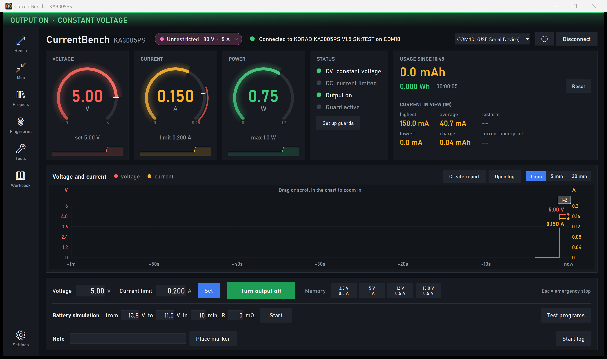

# CurrentBench

**For Korad power supplies**

CurrentBench is a desktop control panel for **Korad KA and KD series** bench power supplies and compatible models: large meters, a live chart, per-project limits, test programs, reports and more. The interface is available in **English, Dutch and German**.

Created by **Ronny Hullegie** ([www.ronnyhullegie.nl](https://www.ronnyhullegie.nl)) with **Claude** (Anthropic): Ronny came up with the idea, decided what it should do and tried it out; Claude wrote the code. Free and non-commercial: a hobby project, built to a professional standard. There is no warranty and no promised support, but bug reports and improvements are welcome.



> **Safety first.** This is hobby software that switches a real power supply. You use it at your own risk. The current limit of the supply itself is the real protection: set it low before you connect anything, and never rely on this program alone to protect your hardware. The panel can stop working at any moment (crash, USB cable, Windows update), and the output then stays as it was.
>
> Unofficial project, not affiliated with or endorsed by Korad. Developed on Windows 11 with a KA3005PS, firmware V1.5. Other models are recognised, but have not been tested. Other operating systems are not supported.

## What it does

- Ring meters for voltage, current and power, with sparklines and a status bar that shows the state at a glance.
- Live chart with zoom, numbered markers and notes.
- **Projects:** your own profiles with a voltage and current limit, colour, memory buttons and guard rules. The panel refuses anything above the limit of the active project.
- **Guards:** rules such as "current above 300 mA for 5 s, turn the output off".
- **Test programs:** sequences of steps and ramps, with an expected current per step and pass/fail in the chart.
- **Startup curve:** raises the voltage slowly from 0 V and plots the current, so faults show up at a few volts.
- **Current fingerprint:** remember how a good board starts and compare every new start against it.
- **Component tester:** forward voltage and polarity of diodes and LEDs, and the value of small resistors.
- **Overnight test**, battery simulation, log comparison, HTML reports and a workbook of everything you measured.
- Bench mode (F11) and a small always-on-top window.
- Phone remote control over your own Wi-Fi, notifications through [ntfy](https://ntfy.sh), and spoken messages.
- A local API so scripts can read and control the panel (off by default).
- Emergency stop: **Esc** always turns the output off, in every window of the panel.

## Getting started

**The easy way:** download `CurrentBench.exe` from the [Releases](https://github.com/RonnyCHL/currentbench/releases) page and start it. It is one file and needs no installation and no Python. The file is not code-signed, so the first time Windows shows "Windows protected your PC": click **More info** and then **Run anyway**.

**From source:** you need Windows 10 or 11 and Python 3.10 or newer.

```
py -m pip install -r requirements.txt
py korad_paneel.py
```

The first start shows a short welcome window with the four steps and the language choice. The main window starts in a **simple** layout; the **Advanced** button next to the memory buttons brings the battery simulation, test programs, notes, logging and usage figures into view.

Connect the supply over USB, choose its COM port and click **Connect**. Before the first real use, keep the terminals empty and check that the readings make sense.

The full manual is in `docs/handleiding` as a PDF in [English](docs/handleiding/handleiding-en.pdf), [Dutch](docs/handleiding/handleiding-nl.pdf) and [German](docs/handleiding/handleiding-de.pdf). You can also open it in the program, under **Tools**.

A one-minute film shows what the program does: [English](docs/film/currentbench-en.mp4), [Dutch](docs/film/currentbench-nl.mp4), [German](docs/film/currentbench-de.mp4).

## Try it without a power supply

Choose **DEMO** in the port list and click **Connect**, or start the panel with `py korad_paneel.py --demo`. The panel restarts with a simulated supply and a small simulated load, and shows **DEMO** in the title bar. It opens no COM port. Demo measurements are not real, and they stay in their own folder, apart from your projects and measurements.

## Supported models

The panel reads the model from the supply and adjusts its range.

| Family | Models | Status |
|---|---|---|
| Korad KA | KA3005PS | tested |
| Korad KA, KD | KA3003P, KA3005P, KA3010P, KA6002P, KA6003P, KA6005P, KD3005P, KD6005P | recognised, untested |
| Tenma | 72-2535, 72-2540, 72-2545, 72-2550, 72-2705, 72-2710 | recognised, untested |
| Velleman | PS3005D, LABPS3005D | recognised, untested |
| RND | 320-KA3005P, 320-KD3005P | recognised, untested |
| Stamos | S-LS-31 | recognised, untested |

Some Velleman PS3005D units use a different protocol and will not connect. Two-channel supplies such as the KA3305P are not supported.

If the panel does not know your model but the supply answers like a Korad, it warns you and asks for the maximum voltage and current on the rating plate. It remembers that range. If your model works, or does not, please open an issue with the model and firmware, so this table can grow. The model list is based on the public documentation of the [sigrok](https://sigrok.org/wiki/Korad_KAxxxxP_series) project.

## Language

The panel starts in the language of Windows, or in English if that is neither Dutch nor German. Change it under **Settings**. To add a language, copy `lang/en.json`, translate the values and add it to `TALEN` in `korad_taal.py`.

## Your own projects

The panel starts with one project, **Unrestricted**, which allows the full range of the connected supply. Open **Projects** and click **Create new project**: give it a name, a voltage and current limit and a colour. If the supply is set higher than the limit of the project you choose, the panel lowers the set voltage (with the output off) or turns the output off. The limit, the memory buttons and the guard rules are stored per project.

## Your data

Everything you create stays on your computer, in `%APPDATA%\CurrentBench`. **Settings > Open data folder** takes you there. To keep everything next to the program, for example on a USB stick, put an empty file named `portable.txt` next to `korad_paneel.py`.

## Reporting a problem

Open **Tools > Error information**. That window collects what is needed to look into a problem: version, Windows, the model of the supply and the last errors. It contains no codes, addresses, serial numbers or project names, and the program sends nothing by itself. **Report on GitHub** copies the text and opens a new [issue](https://github.com/RonnyCHL/currentbench/issues); paste the text and describe what happened. A contact form on [www.ronnyhullegie.nl](https://www.ronnyhullegie.nl), for people without a GitHub account, is on its way.

## Scripts

The local API listens on 127.0.0.1 only, needs a code from the settings file and is off by default. Turn it on under **Settings**. Output on, and raising the voltage while the output is on, require an explicit `akkoord` (consent) in the request. Dialogs on the screen are never answered through the API.

```
py korad_klant.py stand
py korad_klant.py zet 5 0.2
py korad_klant.py aan --akkoord
py korad_klant.py uit
py korad_klant.py acties
```

## Tests

The tests need no power supply and do not touch your own data. `proef_paneel.py` opens every window and runs the main functions against a simulated supply, in one language:

```
py tests/proef_paneel.py en
py tests/proef_demo.py en
py tests/proef_voeding.py
py tests/proef_analyse.py
py tests/proef_vertaling.py
```

## Building the .exe

```
py -m pip install pyinstaller
py tools/maak_exe.py
```

The result is `dist/CurrentBench.exe`, with the translations, the icon and the manuals inside.

## Licence

MIT, see [LICENSE](LICENSE). `qrcodegen.py` is the QR Code generator library by Project Nayuki, also MIT. The icon is drawn by `tools/maak_icoon.py`, part of this project.

The source code uses Dutch names and comments; the translations in `lang/` use the Dutch text as the key.
